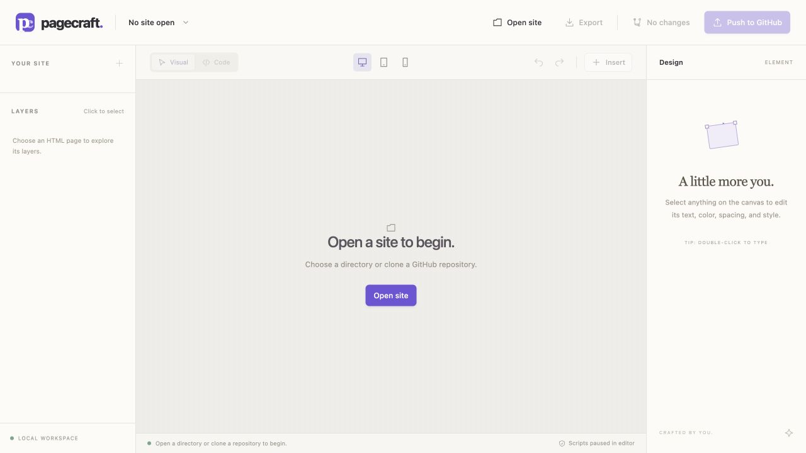

# Pagecraft

A local WYSIWYG HTML editor. Open a site from an existing directory or clone a GitHub repository, edit supported files visually or in Code view, save them to disk, and commit and push from the checkout.



Pagecraft runs on your computer. It has no npm dependencies.

## Run

Install [Node.js 22 or later](https://nodejs.org/) and [Git](https://git-scm.com/). For GitHub repositories, configure Git authentication for your account. Pagecraft uses Git's configured credentials; GitHub CLI is not required for the app workflow.

```sh
git clone https://github.com/jshahbazi/pagecraft.git
cd pagecraft
npm start
```

Open **http://127.0.0.1:4173**. No install or build step is needed. If that port is busy, use `PORT=4174 npm start`.

To explicitly open a directory when Pagecraft starts, pass its path:

```sh
npm start -- /path/to/site-or-repository
# or
npm start -- --directory /path/to/site-or-repository
```

## Open and edit a site

The default workspace is empty. Pagecraft does not open a sample site or restore a cached site automatically. Choose **Open site** and select one of the two options:

1. **Choose a folder** opens the operating system's directory chooser. macOS uses its folder dialog, Windows uses its folder dialog, and Linux uses `zenity` when available. You can also start Pagecraft with an explicit directory path as shown above.
2. **Open a GitHub repository** accepts a GitHub URL or `owner/repository`, clones it into a unique managed checkout under `~/.pagecraft/checkouts`, and opens its detected site folder. Pagecraft uses a blobless, no-checkout clone followed by a sparse checkout of the site source folder so unrelated repository content such as benchmarks is not checked out.

When you open a repository root that has no HTML pages, Pagecraft checks common site folders such as `website/public`, `website/dist`, `public`, and `dist`. You can also choose the site folder directly.

Click an element on the canvas or in **Layers**. Use **Design** to edit text, typography, colors, spacing, links, and image URLs. Double-click text to edit it in place. Use **Insert** to add headings, paragraphs, buttons, sections, or images. Use **Code** for HTML, CSS, JavaScript, JSON, and SVG. Press Backspace or Delete to remove the selected element when you are not editing text, or click **Delete** in the inspector. During inline text editing, these keys delete characters normally.

Use **Save files** or Cmd/Ctrl+S to write changed files to the opened directory. The browser backup is separate from disk saving. Pagecraft keys backups by canonical directory and only reconciles a matching backup when you explicitly open that directory. It does not automatically open a cached workspace on startup. If an edited file changed on disk since the backup, Pagecraft refuses to overlay the conflict; export the draft and reconcile it manually. Browser session tokens renew once automatically, and a valid directory grant is retained while its server process is running.

## Commit and push

**Commit & push** uses the checkout's current branch and configured upstream. Pagecraft commits the selected files' current contents, including existing edits in those files when they were opened. Unrelated unstaged changes remain untouched.

Pagecraft refuses to commit when the checkout has staged changes, preexisting unpushed or diverged commits, changed branch/upstream identity, or external modifications to selected files. Review the selected paths and commit message before proceeding. If a push fails after creating a commit, Pagecraft retains retry state while the server process is running, including across a browser reload. After a server restart, the commit remains in the checkout; finish or reconcile it in Git before reopening the directory in Pagecraft.

Saving uses a conflict preflight and atomic replacement per file. A multi-file save is not a filesystem-wide transaction; if a disk error occurs partway through, Pagecraft reports files already saved. Failed Git commit hooks leave edits saved; a newly added file may remain marked intent-to-add.

A successful push means a Git commit reached the configured remote. Hosting controls deployment. Stark and Planetable require their separate Sites publication workflow; see the [project guide](docs/project-sites.md).

## Supported sites and limits

- Static HTML/CSS sites, including multi-page folders with relative and root-relative assets.
- Up to 300 supported files and 20 MiB of decoded content per workspace. Open the site source folder in large repositories.
- Text: HTML, CSS, JS/MJS, JSON, SVG, TXT, XML, webmanifest, and source maps. Assets: PNG, JPEG, GIF, WebP, AVIF, ICO, WOFF/WOFF2, TTF, OTF, EOT, MP4, WebM, MP3, OGG, WAV, PDF.
- Dotfiles, Git metadata, dependency folders, and unsupported file types are skipped. Local scans skip symbolic links, and saves never follow them.

The visual canvas pauses authored scripts and event handlers. They remain in saved HTML. External stylesheets are not loaded; include CSS in the opened site folder or HTML. React/Next.js source, server-side templates, runtime Tailwind CDNs, and model-driven documents need their own source/build tools. Edit generated output only when it is the maintained source. Script-generated labels should be changed in their script or data source through Code view.

The HTML parser normalizes markup when applying visual edits. Code in authored scripts is preserved; visual edits can change document whitespace and attribute formatting. The inspector's plain-text field replaces inline formatting inside the selected text element; direct canvas editing preserves existing inline markup. Container text replacement is disabled to protect nested layouts. Blurring the canvas to use inspector controls preserves its scroll position.

## Local security model

The server listens only on `127.0.0.1`, validates request host and origin, and requires a per-process session token for directory access, file writes, and publishing actions. GitHub repository access and pushes use Git's configured authentication. Pagecraft does not store credentials in browser storage. Directory reads and writes are constrained to the selected site folder; hidden files, dependencies, and symbolic links are excluded or refused.

This is a local development tool. Do not expose its port through a tunnel or reverse proxy.

## Development

```sh
npm run check
npm test
npm run dev
```

[Verification notes](docs/verification.md) distinguish automated checks from browser and live GitHub checks.

- `server.mjs`: loopback routes, native directory chooser integration, repository clone, and local API.
- `local-workspace.mjs`: scoped directory reads, conflict-checked disk writes, and checkout commit/push.
- `public/workspace-state.js`: browser draft reconciliation after server restart.
- `public/api-client.js`: bounded session renewal and authenticated local requests.
- `public/editor.js`: canonical HTML model and sandboxed visual editing bridge.
- `public/app.js`: workspace, inspector, history, browser backup, disk save, and publishing UI.
- `public/files.js`: path validation and dependency-free ZIP export.

MIT licensed.
